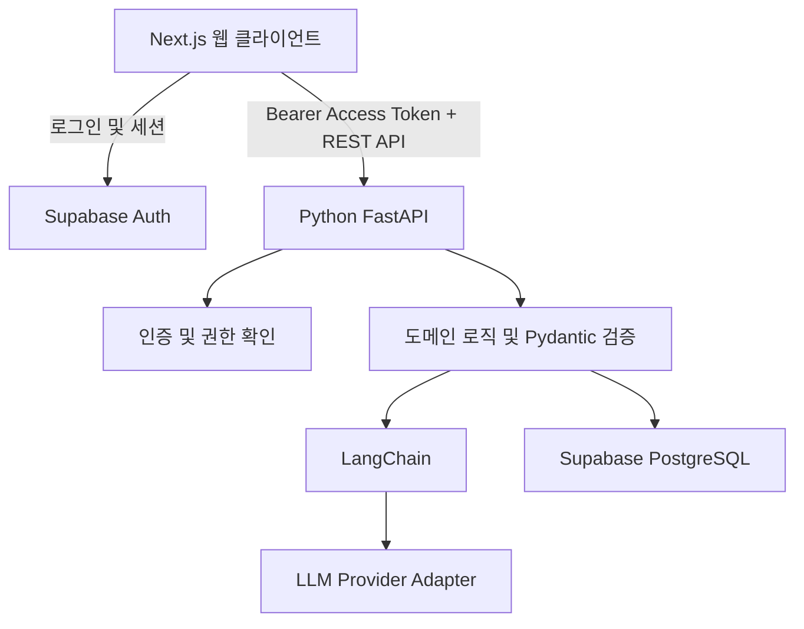

# Tech Stack

## 1. 아키텍처 방향

- **프론트엔드:** Next.js App Router + React + TypeScript
- **백엔드 API:** Python + FastAPI
- **AI 연동:** FastAPI 내부에서 LangChain과 LLM 공급자 어댑터를 사용
- **데이터베이스 및 인증:** Supabase PostgreSQL + Supabase Auth
- **배포:** 프론트엔드 Vercel, 백엔드 Render, 데이터베이스·인증 Supabase

AI 공급자 API 키는 프론트엔드에 노출하지 않는다. 브라우저는 FastAPI의 REST API를 호출하며, FastAPI가 인증 확인·입력 검증·AI 처리·도메인 로직 실행·데이터 저장을 담당한다.

## 2. 기술 스택

| 영역 | 제안 기술 | 사용 목적 및 적용 기준 |
|---|---|---|
| 웹 프레임워크 | Next.js App Router + React | 화면 라우팅, 레이아웃, 서버 렌더링 및 사용자 인터랙션 구현 |
| 프론트엔드 언어 | TypeScript (`strict: true`) | UI와 API 데이터 계약의 타입 안정성 확보 |
| UI 스타일 | Tailwind CSS | 반응형 레이아웃과 디자인 토큰 구성 |
| UI 컴포넌트 | shadcn/ui + Radix UI | 폼, 다이얼로그, 드롭다운, 체크박스, 토스트 등 접근성 있는 기본 UI 구성 |
| 아이콘 | `lucide-react` | 화면 전반의 일관된 아이콘 사용 |
| 클라이언트 API 상태 관리 | `@tanstack/react-query` + 공통 `fetch` 래퍼 | FastAPI 요청, 캐싱, 로딩·오류 상태 및 변경 후 재조회 관리. 단순한 화면 상태는 React 상태로 관리 |
| 프론트엔드 폼 | `react-hook-form` + `@hookform/resolvers` + Zod | 입력 화면 검증 및 사용자 오류 안내. 최종 서버 검증은 백엔드에서 수행 |
| 날짜 처리 | `date-fns` | 주간 날짜 계산, 날짜 표시, 월간 주차 스트립 구현 |
| 백엔드 언어 | Python 3.12 | AI 라이브러리 생태계와의 호환성을 고려한 기본 실행 환경 |
| 백엔드 프레임워크 | FastAPI | REST API 구현, 의존성 주입, 요청 처리 및 OpenAPI 문서 자동 생성 |
| ASGI 서버 | Uvicorn | FastAPI 애플리케이션 실행 |
| 백엔드 데이터 모델·검증 | Pydantic v2 | API 요청·응답, AI 출력, 설정값 및 도메인 데이터의 타입·제약 조건 검증 |
| 환경 설정 | `pydantic-settings` | 환경변수 및 비밀 설정값을 타입 안전하게 관리 |
| AI 오케스트레이션 | LangChain Python (`langchain`, `langchain-core`) | 레시피 구조화, 식단 추천, 메뉴 변경 제안, 대체 재료 설명 등 LLM 호출 흐름 구성 |
| AI 공급자 어댑터 | 공급자별 LangChain 통합 패키지. `langchain-openai` | 공급자 API 호출을 LangChain 인터페이스 뒤에 분리. |
| AI 구조화 응답 | LangChain structured output + Pydantic 모델 | AI 응답을 정의된 스키마로 받거나 검증하고, 필수 필드 누락·잘못된 타입·허용 범위 밖 값을 처리 |
| URL 본문 추출 | `httpx` + `trafilatura`; 필요 시 `beautifulsoup4` 보조 | 레시피 URL의 HTML을 가져와 본문 텍스트를 추출. 사이트별 차단·동적 렌더링·본문 추출 실패를 고려해 오류와 재입력 경로 제공 |
| 데이터베이스 | Supabase PostgreSQL | 사용자별 레시피, 식단, 레시피 재료, 대체 재료 적용 정보, 장보기 목록, 조리 이력 저장 |
| 백엔드 DB 클라이언트 | `supabase-py` | FastAPI에서 Supabase Data API 및 관련 기능 접근. 사용자 요청은 사용자 인증 토큰과 RLS 정책을 기준으로 접근 범위를 제한 |
| 인증 | Supabase Auth + 프론트엔드 `@supabase/supabase-js` | 로그인·세션 관리 및 Access Token 발급. |
| API 인증·권한 | FastAPI 인증 의존성 + Supabase JWT 검증 | 보호된 API에서 토큰을 검증하고 토큰의 사용자 식별자를 기준으로 권한 확인. 요청 본문이 전달한 사용자 ID를 그대로 신뢰하지 않음 |
| API 계약 | FastAPI OpenAPI + Pydantic | 백엔드 요청·응답 계약을 단일 기준으로 정의하고 `/docs`에서 문서 확인. 프론트엔드 타입은 OpenAPI에서 생성하거나 계약 변경 시 함께 갱신 |
| 프론트엔드 테스트 | Vitest + React Testing Library | UI 동작, 폼 검증, 로딩·오류 상태 검증 |
| 백엔드 테스트 | `pytest` + FastAPI `TestClient` 또는 `httpx` | API·권한·검증·오류 처리 테스트. AI 공급자 호출은 기본적으로 mock 처리해 테스트 비용과 변동성 방지 |
| E2E 테스트 | Playwright | 식단 생성부터 수정, 장보기 목록 확인, 요리 완료 표시까지 핵심 사용자 흐름 검증 |
| 코드 품질 | ESLint + Prettier / Ruff | 프론트엔드와 Python 코드의 정적 검사 및 포맷 일관성 유지 |
| 프론트엔드 패키지 관리 | pnpm | JavaScript 의존성 및 lockfile 관리 |
| Python 패키지 관리 | `uv` | Python 의존성, 가상환경 및 lockfile 관리 |
| 배포 | Vercel + Render + Supabase | 프론트엔드와 Python API를 분리 배포하고 데이터베이스·인증은 Supabase로 관리 |
| 비밀값 관리 | 배포 환경변수 및 로컬 `.env` | LLM API 키, Supabase 키 등 비밀값 관리. `.env` 파일은 저장소에 커밋하지 않음 |

## 3. 프론트엔드와 백엔드의 책임 경계

### 프론트엔드

- 화면 렌더링, 사용자 입력, 로딩·오류 표시를 담당한다.
- Supabase Auth를 통해 세션을 관리하고, 보호된 FastAPI 요청에 Access Token을 전달한다.
- UI 수준의 입력 검증을 제공하되 보안 및 데이터 무결성 검증을 대체하지 않는다.
- LLM 공급자 API를 직접 호출하지 않으며, 공급자 API 키를 포함하지 않는다.

### Python 백엔드

- 인증·권한 확인, 요청 검증, 도메인 로직, AI 호출, DB 반영을 담당한다.
- AI 기능은 LangChain 서비스 모듈로 분리하고, API 라우터에 프롬프트와 공급자 호출 코드를 직접 작성하지 않는다.
- 재료량 계산, 인분 배율, 단위 호환성, 날짜 계산, 공통 재료 합산 등 데이터 무결성에 영향을 주는 계산은 **결정론적인 Python 도메인 함수**로 처리한다. LLM이 계산 결과를 임의로 확정하게 하지 않는다.
- AI 응답은 Pydantic 검증 및 도메인 규칙 검사를 통과한 뒤에만 저장 가능한 데이터로 취급한다.
- AI 처리 실패, 시간 초과, 공급자 오류, 응답 스키마 오류에 대해 사용자에게 반환할 오류를 구분한다.

## 4. 인증·데이터 접근 원칙

1. 브라우저는 Supabase Auth에서 발급받은 Access Token을 `Authorization: Bearer <token>` 형식으로 FastAPI에 전달한다.
2. FastAPI는 토큰의 서명·발급자·만료 등 유효성을 확인한 뒤 사용자 식별자를 요청 컨텍스트에 둔다.
3. 사용자 소유 데이터는 인증된 사용자 범위로 조회·수정하고, Supabase의 Row Level Security(RLS) 정책을 활성화한다.
4. 일반 사용자 요청 처리에 `service_role` 키를 사용하지 않는다. 해당 키는 RLS를 우회할 수 있으므로, 꼭 필요한 서버 전용 관리 작업에서만 별도 경로로 제한한다.
5. Supabase URL, 공개 키, 서버 비밀키, LLM API 키의 노출 범위를 구분한다. LLM API 키와 서버 비밀키는 서버 환경변수에만 둔다.
6. 외부 URL 본문을 가져올 때는 내부망·로컬 주소 및 허용되지 않은 프로토콜 접근을 차단하고, 요청 시간 제한과 본문 크기 제한을 적용해 SSRF 및 과도한 다운로드 위험을 줄인다.

## 5. AI 응답과 도메인 데이터 원칙

- 레시피 추출, 메뉴 추천, 대체 재료 설명 등 LLM을 사용하는 기능은 각 기능에 맞는 Pydantic 스키마를 명시한다.
- 가능한 경우 LangChain의 구조화 응답 기능을 사용한다. 구조화 출력은 타입 검증을 돕지만, 재료의 실제 단위·수량·대체 가능성까지 보증하는 것은 아니므로 별도 도메인 검증을 수행한다.
- 모델명과 AI 공급자 설정은 코드 곳곳에 하드코딩하지 않고 환경 설정 모듈에서 관리한다.
- 타임아웃, 재시도 횟수, 토큰 사용 한도, 오류 로깅 정책을 설정한다. 자동 재시도는 비용이 발생하는 요청임을 고려해 제한한다.
- 개발·테스트에서는 실제 LLM 호출을 모킹할 수 있도록 AI 서비스 인터페이스를 분리한다.
- 프롬프트와 로그에 사용자 데이터가 포함될 수 있으므로, 민감한 내용을 불필요하게 기록하지 않는다. LangSmith 등 별도 추적 도구는 필요성·비용·데이터 처리 정책 확인 후 선택한다.

이 구조는 권장 초안이다. 저장소를 하나로 둘지 프론트엔드·백엔드 저장소를 분리할지는 팀 운영 방식에 따라 결정할 수 있다.
