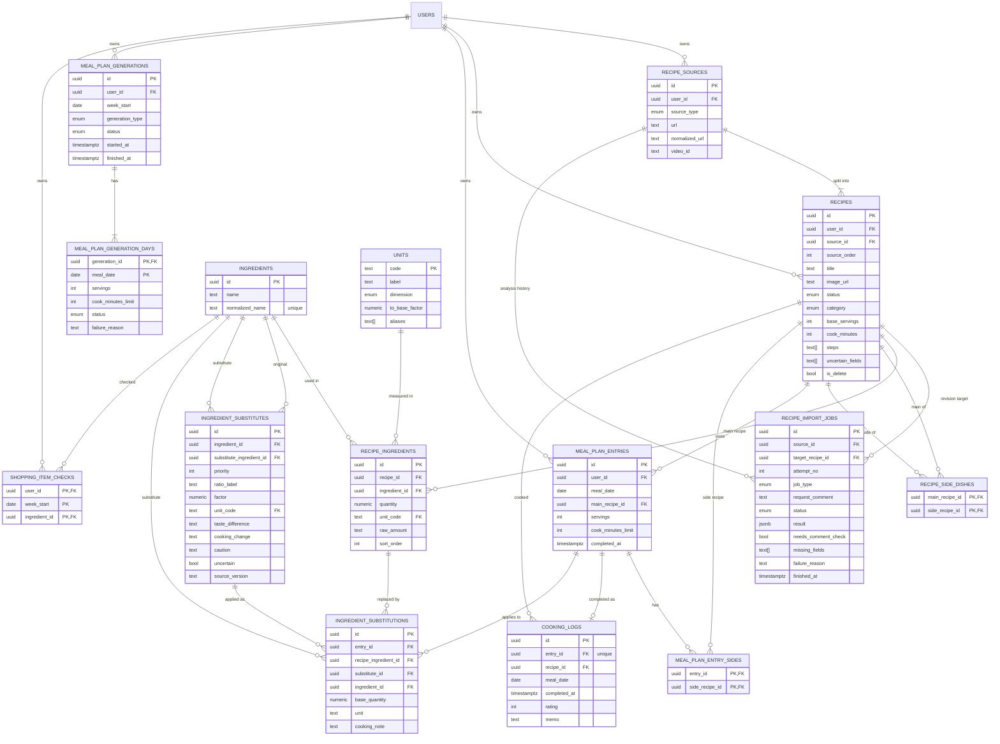

# 데이터 구조 (ERD 검토용)

> 근거: `frontend/lib/api/contracts.ts`(API 계약), `frontend/mocks/db.ts`(mock 저장 구조), `docs/product/FEATURE_SPEC.md`, `backend/BUSINESS_LOGICS.md`
> 목적: ERD 확정 전에 **엔티티, 주요 필드, 엔티티 간 관계**를 검토한다. 컬럼 타입·인덱스·RLS 정책 상세는 ERD 확정 후 정리한다.

공통 규칙
- DB 컬럼은 snake_case, API JSON은 camelCase (Pydantic `alias_generator=to_camel`)
- PK는 `uuid`, 사용자 소유 테이블은 모두 `user_id`(Supabase `auth.users.id`)를 가지고 RLS로 접근 제한
- `null` 수량·인분·시간은 "미확인" — 추정값을 저장하지 않는다
- 공통 컬럼 `created_at`, `updated_at`은 표에서 생략
- AI 분석 결과는 **history로 누적 저장**하고, 가장 최신 결과만 적용할 수 있다

---

## 1. ERD

---

## 2. 엔티티와 주요 필드

### 2.1 레시피 영역

**RECIPE_SOURCES — 레시피 출처** (출처 1 : 레시피 1..N)

| 필드 | 설명 |
|---|---|
| `id`, `user_id` | PK, 소유 사용자 |
| `source_type` | `youtube` / `naver_blog` / `10000recipe` / `web` |
| `url` | 사용자가 입력한 원본 URL (실패해도 보존) |
| `normalized_url` | 중복 확인용 정규화 URL (스킴·`www`·추적 파라미터 정리, 만개의레시피는 레시피 ID로 만든 `https://www.10000recipe.com/recipe/{id}`) |
| `video_id` | 유튜브 영상 ID (유튜브만) |

- 중복 기준: 유튜브는 `(user_id, video_id)`, 그 외는 `(user_id, normalized_url)` 유니크
  - 만개의레시피는 URL 맨 뒤 레시피 ID(예: `.../recipe/7069580` → `7069580`)를 정규표현식으로 추출해 `normalized_url`을 만들므로, 사실상 `(user_id, 레시피 ID)` 기준 (`BUSINESS_LOGICS.md` §1.4)
- 출처 하나에서 레시피가 여러 개 나오면 레시피별로 분리 저장 (`logics/RECIPE_ANALYSIS.md` §5)
- 같은 출처를 다시 요청하면 새 레시피를 만들지 않고 기존 레시피를 안내 → 사용자는 **수정 요청**으로 결과를 보완
- 그 출처의 레시피가 soft delete 상태면 새로 만들지 않고 **기존 레시피를 복구**(`is_delete=false`). 일부만 삭제된 경우 삭제된 레시피를 복구하고 기존 레시피를 안내
- API에는 테이블 구조를 노출하지 않고 기존처럼 `Recipe.sourceUrl` 문자열로 응답 (조회 시 `url`만 조인)

**RECIPES — 레시피**

| 필드 | 설명 |
|---|---|
| `id`, `user_id` | PK, 소유 사용자 |
| `source_id` | FK → RECIPE_SOURCES |
| `source_order` | 출처 안의 레시피 순번 — `(source_id, source_order)` 유니크 |
| `title` | 레시피명 (사용자 입력 또는 추출, 미확인 시 `null`) |
| `image_url` | 대표 이미지 (`og:image`, 유튜브 썸네일) |
| `status` | `importing` / `needs_review` / `saved` / `failed` |
| `category` | `soup` / `side` / `main` / `simple` / `set` |
| `base_servings`, `cook_minutes` | 기준 인분, 예상 조리 시간 |
| `steps` | 조리 순서 `text[]` (별도 테이블 없음) |
| `uncertain_fields` | 최신 분석 결과에서 확정하지 못한 필드 |
| `is_delete` | soft delete 여부 |

- `failureReason`, 시도 횟수는 최신 RECIPE_IMPORT_JOBS에서 조회

**RECIPE_IMPORT_JOBS — 수집·AI 분석 이력** (history)

| 필드 | 설명 |
|---|---|
| `source_id` | FK → RECIPE_SOURCES (분석은 출처 단위) |
| `target_recipe_id` | 수정 요청 대상 레시피 (`revision`만, 나머지는 `null`) |
| `attempt_no` | 출처별 순번 (최신 판단 기준) |
| `job_type` | `import`(최초) / `retry`(재시도) / `revision`(수정 요청) |
| `request_comment` | 수정 요청 코멘트 (`revision`만) |
| `status` | `running` / `succeeded` / `failed` |
| `result` | AI 구조화 결과 원본 (`jsonb`) |
| `needs_comment_check`, `missing_fields` | 유튜브 Gemini 분석 결과 (댓글 보완 필요 여부·누락 항목) |
| `failure_reason`, `finished_at` | 실패 사유, 완료 시각 |

- 레시피의 `title`·재료·`steps`·곁들임 연결은 **출처의 가장 최신 job 성공 결과만** 반영. 이전 job이 늦게 끝나도 최신이 아니면 적용하지 않음
- `revision` job은 `target_recipe_id` 레시피에만 반영하며, 출처에 접속하지 않고 저장된 레시피 데이터 + 코멘트로 처리 (완전 실패 상태의 수정 요청만 출처 재분석)
- 출처 분석(`import`, `retry`)은 출처별 최신 job, `revision`은 대상 레시피별 최신 job만 반영
- 유튜브 댓글 원문은 저장하지 않음

**INGREDIENTS — 재료 마스터**
- `name`(원문 표기), `normalized_name`(유니크, 장보기 합산·대체 규칙 키)
- 재료 행은 표기별로 독립: "마늘"과 "다진 마늘"은 서로 다른 행이며 상하위 관계 없음
- `normalized_name`은 공백·대소문자만 정리 (손질·형태 표현은 유지)
- AI 추출 재료명은 `normalized_name`으로 매칭, 없으면 신규 생성
- 전 사용자 공용 마스터 (`user_id` 없음, 사용자 연동 안 함). 사용자별 재료 관리는 MVP 제외
- RLS: 사용자는 읽기만, 생성·수정은 서버에서만

**RECIPE_INGREDIENTS — 레시피-재료 중개 테이블** (`RecipeIngredient`)

| 필드 | 설명 |
|---|---|
| `recipe_id`, `ingredient_id` | FK → RECIPES, INGREDIENTS(마스터) |
| `quantity` | 필요량 숫자 (미확인·비정량 `null`) |
| `unit_code` | FK → UNITS (매칭 안 되면 `null`) |
| `raw_amount` | 원문 수량 표기 (예: "1/2큰술", "약간", "2~3개") |
| `sort_order` | 표시 순서 |

**UNITS — 단위 코드** (규칙은 `BUSINESS_LOGICS.md` §4.5, 사용자에게는 레시피 상세의 `환산 규칙` 외부 링크로 기준표 제공)
- `code`(PK, 예: `g`, `ml`, `tbsp`, `ea`), `label`(표시명), `dimension`(`mass` / `volume` / `count` / `unmeasured`), `to_base_factor`(기준 단위 환산 계수, `count`·`unmeasured`는 `null`), `aliases`(표기 정규화용 별칭)
- 서버 시드로 관리하는 공용 코드 테이블

**RECIPE_SIDE_DISHES — 사용자 지정 곁들임 (M : N)** (F-04)
- `main_recipe_id`, `side_recipe_id` 복합 PK, 레시피 데이터를 복제하지 않는 관계
- 식단 생성 시 AI 곁들임 추천의 근거 데이터

### 2.2 식단 영역

**MEAL_PLAN_ENTRIES — 날짜별 식단 항목** (`MealPlanEntry`)

| 필드 | 설명 |
|---|---|
| `id`, `user_id` | PK, 소유 사용자 |
| `meal_date` | 날짜 — `(user_id, meal_date)` 유니크 (하루 1개) |
| `main_recipe_id` | FK → RECIPES (주 레시피) |
| `servings` | 계획 인분 (1 이상) |
| `cook_minutes_limit` | 조리 시간 설정 (평일 30 / 주말 70 기본) |
| `completed_at` | 요리 완료 시각 (`null` = 미완료) |

- 생성 즉시 확정 → `draft` 상태 컬럼 없음

**MEAL_PLAN_ENTRY_SIDES — 특정 날짜 식단의 레시피 조합** (`MealPlanEntry.sideRecipes`)
- `entry_id`, `side_recipe_id` 복합 PK
- RECIPE_SIDE_DISHES(사용자 지정 관계)와 별개로, 해당 날짜 식단에 실제 구성된 곁들임만 저장

**MEAL_PLAN_GENERATIONS — 식단 추천 실행 기록** (`WeeklyMealPlan.generation`)
- 추천을 실행할 때마다 1건: `user_id`, `week_start`, `generation_type`(`weekly` 주간 생성 / `regenerate` 날짜별 변경), `status`(`generating` / `complete` / `partial` / `failed`), `started_at`, `finished_at`
- 주의 생성 상태는 그 주의 가장 최신 기록으로 응답, 기록이 없으면 `none`
- 같은 사용자·같은 주에 `generating`이 있으면 새 실행을 시작하지 않음 (`logics/MEAL_RECOMMENDATION.md` §6)

**MEAL_PLAN_GENERATION_DAYS — 날짜별 추천 결과**
- `(generation_id, meal_date)` 복합 PK, `servings`, `cook_minutes_limit`(요청 조건), `status`(`pending` / `success` / `failed`), `failure_reason`
- `WeeklyMealPlan.generation.failedDates`는 최신 기록의 `failed` 날짜 중 아직 식단이 없는 날짜

### 2.3 조리 기록 영역

**COOKING_LOGS — 요리 완료 이력 + 평가** (`CookingLogSummary`, F-08·F-09)
- `entry_id`(유니크 → 중복 완료 시 이력 1건 유지), `recipe_id`, `meal_date`, `completed_at`, `rating`(선택), `memo`(선택)
- 레시피 상세의 `cookingLogs`, 조리 화면의 `previousLogs`는 `recipe_id`로 조회

### 2.4 장보기·대체 재료 영역

**INGREDIENT_SUBSTITUTES — 대체 재료 베이스 데이터** (`SubstituteCandidate`, 공용)
- 서비스 운영 전 사전 작업으로 생성·검수해 적재 (`logics/PREP_SUBSTITUTE_BASE_DATA.md`), 런타임 AI 호출 없음
- `ingredient_id`(원래 재료), `substitute_ingredient_id`(대체 재료), `priority`(1~2), `ratio_label`, `factor`(필요량 배수, 미확인 `null`), `unit_code`, `taste_difference`, `cooking_change`, `caution`, `uncertain`, `source_version`(생성 모델·지시문 버전)
- `(ingredient_id, substitute_ingredient_id)` 유니크, 사용자는 읽기만
- API의 `candidateId` = 이 테이블의 `id`

**INGREDIENT_SUBSTITUTIONS — 적용된 대체 재료** (F-06)
- `entry_id` + `recipe_ingredient_id` 유니크 → 특정 날짜·특정 레시피의 재료에만 적용 (전역 아님)
- `substitute_id`(적용한 베이스 후보), `ingredient_id`(대체 재료), `base_quantity`(기준 인분 기준, 미확인 `null`), `unit`, `cooking_note`(원문 조리 순서와 분리된 대체 조리 안내)
- 적용 시 후보가 해당 재료의 베이스 후보인지 검증

**SHOPPING_ITEM_CHECKS — 장보기 준비 여부** (`ShoppingItem.checked`)
- `(user_id, week_start, ingredient_id)` 복합 PK
- 행이 있으면 준비 완료, 없으면 미준비
- 식단 변경 시 더 이상 필요 없는 재료의 행은 삭제 (보유 여부 유지 / 신규 미준비 규칙)

---

## 3. 엔티티 간 관계

| 관계 | 카디널리티 | 설명 |
|---|---|---|
| RECIPE_SOURCES → RECIPES | 1 : 1..N | 한 출처의 레시피 여러 개를 분리 저장, 같은 출처 재요청 시 수정 요청으로 반영 |
| RECIPE_SOURCES → RECIPE_IMPORT_JOBS | 1 : N | 출처 단위 분석 이력, 최신 성공 결과만 반영 |
| RECIPES → RECIPE_IMPORT_JOBS | 1 : N | 수정 요청 대상 (`target_recipe_id`) |
| RECIPES ↔ INGREDIENTS (RECIPE_INGREDIENTS) | N : M | 중개 테이블에 필요량·단위·원문 수량 표기 |
| UNITS → RECIPE_INGREDIENTS | 1 : N | 단위 코드 (nullable) |
| RECIPES ↔ RECIPES (RECIPE_SIDE_DISHES) | N : M | 사용자 지정 곁들임 (자기 참조) |
| RECIPES → MEAL_PLAN_ENTRIES | 1 : N | 주 레시피 |
| MEAL_PLAN_ENTRIES ↔ RECIPES (MEAL_PLAN_ENTRY_SIDES) | N : M | 특정 날짜 식단의 곁들임 조합 |
| MEAL_PLAN_ENTRIES → COOKING_LOGS | 1 : 0..1 | 완료 시 1건 생성, 멱등 |
| RECIPES → COOKING_LOGS | 1 : N | 같은 레시피를 다른 날 요리하면 이력 분리 |
| INGREDIENTS → INGREDIENT_SUBSTITUTES | 1 : 0..2 | 재료별 대체 베이스 후보 (대체 재료도 INGREDIENTS 참조) |
| INGREDIENT_SUBSTITUTES → INGREDIENT_SUBSTITUTIONS | 1 : N | 적용 시 어떤 후보를 썼는지 기록 |
| (MEAL_PLAN_ENTRIES, RECIPE_INGREDIENTS) → INGREDIENT_SUBSTITUTIONS | 1 : 0..1 | 식단·재료별 적용된 대체 1건, 식단 재생성·변경 시 삭제 |
| INGREDIENTS → SHOPPING_ITEM_CHECKS | 1 : N | 주·재료별 준비 여부 |
| MEAL_PLAN_GENERATIONS → MEAL_PLAN_GENERATION_DAYS | 1 : 1..N | 추천 실행별 날짜 진행·결과, 주별 최신 실행이 현재 상태 |

삭제 정책
- 레시피 삭제는 **soft delete**(`is_delete=true`): 과거 식단·조리 기록·대체 이력의 참조를 유지
- 삭제된 레시피는 목록·식단 후보·곁들임 추천에서 제외
- 오늘 이후 식단에 사용 중인 레시피는 삭제 요청 시 `409` (기존 규칙 유지)
- 출처·분석 이력·재료 연결은 레시피와 함께 남김 (물리 삭제 없음)
- 삭제된 레시피의 출처를 다시 추가하면 기존 레시피 복구 (출처 유니크 제약 유지)

---

## 4. 저장하지 않고 계산하는 데이터

| API 데이터 | 계산 근거 |
|---|---|
| `ShoppingList.items`, `amounts`, `sources`, `substituteFor` | 해당 주 MEAL_PLAN_ENTRIES + 곁들임 + RECIPE_INGREDIENTS + INGREDIENT_SUBSTITUTIONS로 매번 계산 (인분 환산, `ingredient_id`·UNITS 차원 기준 합산). 항목명은 INGREDIENTS.`name` ("마늘"·"다진 마늘"은 별도 항목) |
| `ScaledIngredient.name` | INGREDIENTS.`name` (대체 적용 시 대체 재료명) |
| `ShoppingList.neededCount` | items 중 SHOPPING_ITEM_CHECKS에 없는 항목 수 |
| `ScaledIngredient.quantity` | `quantity × (servings ÷ base_servings)` |
| `MonthSummary.weeks[].hasMeals` | 주 범위 내 MEAL_PLAN_ENTRIES 존재 여부 |
| `TodayMealResponse.hasSavedRecipes` | `status=saved`, `is_delete=false` 레시피 존재 여부 |
| `MealPlanEntry.cookingLogId` | COOKING_LOGS.`entry_id`로 조회 |
| `Recipe.failureReason` | 최신 RECIPE_IMPORT_JOBS의 `failure_reason` |
| `Recipe.sourceUrl` | RECIPE_SOURCES.`url` |

---

## 5. API 계약 ↔ 엔티티 매핑

| contracts.ts 타입 | 엔티티 |
|---|---|
| `Recipe` | RECIPES + RECIPE_SOURCES(`url`) + RECIPE_INGREDIENTS·INGREDIENTS + 최신 RECIPE_IMPORT_JOBS + COOKING_LOGS |
| `RecipeIngredient` | RECIPE_INGREDIENTS(`quantity`) + INGREDIENTS(`name`) + UNITS(`label`) |
| `RecipeSummary` | RECIPES |
| `MealPlanEntry` | MEAL_PLAN_ENTRIES + MEAL_PLAN_ENTRY_SIDES + COOKING_LOGS |
| `WeeklyMealPlan.generation` | 최신 MEAL_PLAN_GENERATIONS + MEAL_PLAN_GENERATION_DAYS |
| `CookingRecipeView` | RECIPES + RECIPE_INGREDIENTS + INGREDIENT_SUBSTITUTIONS + COOKING_LOGS + RECIPE_SOURCES |
| `CookingLogSummary` | COOKING_LOGS |
| `ShoppingItem` | 계산값 + SHOPPING_ITEM_CHECKS (`id` = `ingredient_id`) |
| `SubstituteCandidate` | INGREDIENT_SUBSTITUTES (+ 레시피 수량 × `factor` 계산) |
| `AppliedSubstitute` | INGREDIENT_SUBSTITUTIONS |

API 계약에 영향이 있는 변경 (프론트 `contracts.ts`·mock 반영 필요)
- `ImportRecipeRequest.allowDuplicate`: 같은 출처 별도 저장을 하지 않으므로 제거 대상
- `ShoppingItem.id`: 정규화 재료명 → `ingredient_id`

---

## 6. 결정 사항 (2026-10-16)

| # | 항목 | 결정 |
|---|---|---|
| 1 | 출처 API 노출 | `sourceUrl` 문자열 유지, 출처 테이블은 내부 구조 |
| 2 | 출처-레시피 관계 | 1 : 1..N (한 출처의 여러 레시피는 분리 저장 + 곁들임 관계 분석), 같은 출처 재요청은 수정 요청으로 반영 |
| 3 | 조리 순서 저장 | `recipes.steps text[]` 필드 |
| 4 | 곁들임 | 사용자 지정 M : N(RECIPE_SIDE_DISHES) + 날짜별 식단 조합(MEAL_PLAN_ENTRY_SIDES) 2가지 |
| 5 | AI 분석 결과 | history로 저장, 최신 결과만 적용 (레시피 수집 분석) |
| 6 | 재료 | INGREDIENTS 마스터 + RECIPE_INGREDIENTS 중개 테이블(필요량·단위) |
| 7 | 수집 작업 이력 | RECIPE_IMPORT_JOBS 추가 |
| 8 | 유튜브 댓글 원문 | 저장하지 않음 |
| 9 | 레시피 삭제 | `is_delete` soft delete |
| 10 | 재료 마스터 범위 | 전 사용자 공용, 사용자 연동 안 함 (사용자별 재료는 MVP 제외) |
| 11 | 단위 체계 | UNITS 코드 테이블 + 환산 규칙 (`BUSINESS_LOGICS.md` §4.5), 컵 200ml, 레시피 상세 재료 영역의 `환산 규칙` 외부 링크로 기준표 제공 |
| 12 | 재료 표기 | 표기별 독립 재료 행 ("마늘"과 "다진 마늘"은 서로 다른 재료) |
| 13 | 삭제된 레시피 출처 재요청 | 기존 레시피 복구 |
| 14 | 대체 재료 | 런타임 AI 제안 대신 사전 작업 베이스 데이터(INGREDIENT_SUBSTITUTES), 제안 이력 테이블 제거 |
| 15 | 식단 추천 상태 | 실행·날짜별 상태 저장 (MEAL_PLAN_GENERATION_DAYS), 주간 생성 실패 날짜는 식단 없음 |

## 7. 남은 검토 사항

1. **환산 규칙 문서 위치**: 외부 링크로 연결할 `docs/product/UNIT_GUIDE.md`의 호스팅 위치·URL
